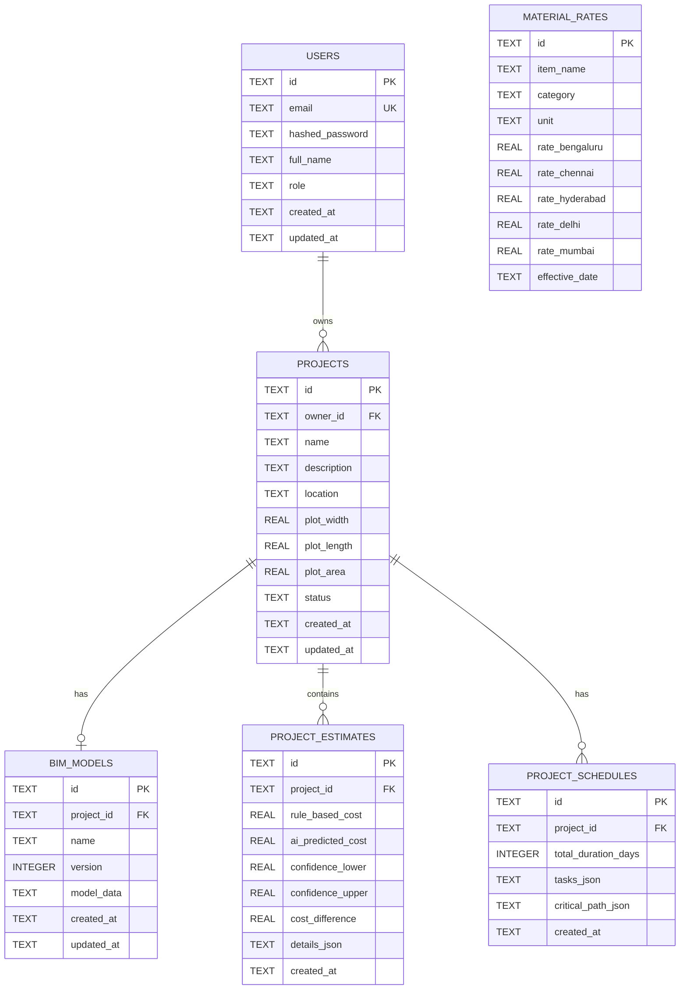

# SMARTBUILD AR/VR: System Architecture & Technical Specifications

---

## 1. Monorepo Repository Structure

```
smartbuild-ar-vr/
├── backend/
│   ├── app/
│   │   ├── main.py                     # FastAPI application entrypoint & middleware
│   │   ├── core/
│   │   │   ├── config.py               # Application settings & environment variables
│   │   │   └── security.py             # Bcrypt password hashing & JWT token issuance
│   │   ├── database/
│   │   │   └── database.py             # SQLite connection provider & schema initialiser
│   │   ├── schemas/
│   │   │   └── common.py               # Pydantic schemas (User, Project, BIM, Cost, AI, Schedule)
│   │   ├── api/
│   │   │   ├── deps.py                 # Dependency injection (Auth guard)
│   │   │   ├── auth.py                 # Signup, login, profile endpoints
│   │   │   ├── projects.py             # CRUD project management
│   │   │   ├── bim.py                  # Parametric BIM house generator & 3D data API
│   │   │   ├── quantities.py           # IS 1200 automated QTO & BOQ API
│   │   │   ├── costs.py                # 5D itemized cost estimation API
│   │   │   ├── ai.py                   # Machine learning prediction & CI API
│   │   │   ├── optimize.py             # Material substitution optimization API
│   │   │   ├── schedule.py             # 4D CPM construction schedule API
│   │   │   └── reports.py              # Consolidated academic project report API
│   │   └── services/
│   │       ├── bim_service.py          # Parametric geometric building model generator
│   │       ├── quantity_service.py     # Deterministic engineering volumetric engine
│   │       ├── cost_service.py         # 5D cost breakdown & regional rate matrices
│   │       ├── ai_service.py           # ML inference engine & feature transformation
│   │       ├── optimize_service.py     # Cost reduction substitution calculator
│   │       ├── schedule_service.py     # Critical Path Method forward/backward pass
│   │       └── report_service.py       # Comprehensive project report compiler
│   └── venv/                           # Dedicated Python 3.14 virtual environment
│
├── frontend/
│   ├── app/
│   │   ├── layout.tsx                  # Global root layout with metadata & fonts
│   │   ├── globals.css                 # Tailwind CSS styles & design tokens
│   │   ├── page.tsx                    # Academic landing page with literature & RQs
│   │   ├── login/page.tsx              # Secure JWT login interface
│   │   ├── signup/page.tsx             # User registration interface
│   │   ├── dashboard/page.tsx          # Project manager & creator
│   │   └── projects/[projectId]/
│   │       └── page.tsx                # Unified 10-module engineering workspace
│   ├── components/
│   │   ├── viewer/
│   │   │   ├── BIM3DViewer.tsx         # Three.js 3D viewer with raycast element selection
│   │   │   └── WebXRViewer.tsx         # WebXR VR 1.7m eye-level & AR surface projector
│   │   ├── house/
│   │   │   └── HouseConfigurator.tsx   # Parametric room/floor architectural editor
│   │   ├── cost/
│   │   │   ├── QuantitiesTable.tsx     # QTO & priced Bill of Quantities (BOQ)
│   │   │   ├── CostEstimationView.tsx  # 5D cost breakdown & regional rate tables
│   │   │   ├── AIPredictionView.tsx    # ML prediction vs 5D cost & confidence interval
│   │   │   └── OptimizationView.tsx    # Cost driver substitution scenarios
│   │   ├── schedule/
│   │   │   └── GanttScheduleView.tsx   # 4D interactive CPM Gantt timeline
│   │   └── reports/
│   │       └── ProjectReportView.tsx   # Academic dissertation report with export
│   ├── lib/
│   │   └── api.ts                      # Typed REST client with bearer token injection
│   ├── types/
│   │   └── index.ts                    # TypeScript interface definitions
│   └── package.json                    # Next.js 15, React 19, Three.js, Lucide
│
├── ml/
│   ├── generate_dataset.py             # Generates 1,200 calibrated residential records
│   ├── train.py                        # Trains OLS, Random Forest, Gradient Boosting
│   ├── predict.py                      # Standalone inference & CI evaluation script
│   ├── evaluate.py                     # Generates cross-validation performance metrics
│   ├── data/raw/
│   │   └── residential_construction_data.csv # Training dataset
│   └── models/
│       ├── best_model.pkl              # Serialized Gradient Boosting pipeline
│       └── metrics.json                # Evaluated cross-validation metrics
│
├── database/
│   ├── schema.sql                      # Relational schema (Users, Projects, BIM, Rates)
│   └── seed.sql                        # Regional rate matrices across 5 major cities
│
├── tests/
│   ├── test_auth_api.py                # End-to-end authentication & project lifecycle
│   ├── test_ml_prediction.py           # ML inference, CI sanity, and feature bounds
│   └── test_qto_geometry.py            # Geometric QTO deductions & structural steel ratios
│
└── docs/
    ├── research/
    │   ├── LITERATURE_REVIEW.md        # Academic literature foundation & RQs
    │   └── METHODOLOGY_AND_EVALUATION.md # Formulations, ML metrics & CPM algorithms
    └── architecture/
        └── SYSTEM_ARCHITECTURE.md      # Data schemas, API specifications & security
```

---

## 2. Database Schema (Relational SQLite)



---

## 3. Security & Authentication Architecture

1. **Password Encryption**: Passwords are cryptographically hashed using **direct standard bcrypt** with a random salt factor of 12. Password input is strictly sliced to 72 bytes before hashing to guarantee security standards compliance.
2. **Stateless JWT Tokens**: Upon successful authentication (`/api/auth/login` or `/api/auth/signup`), the backend signs an HS256 JWT containing the user ID subject (`sub`) and an expiration timestamp (default: 1440 minutes / 24 hours).
3. **Authorization Guard**: The FastAPI dependency `get_current_user` extracts the `Authorization: Bearer <token>` header, decodes and verifies the signature, and rejects requests with HTTP 401 Unauthorized if invalid or expired.
4. **Data Isolation**: All project queries execute parameterized SQL statements enforcing `WHERE owner_id = :current_user_id`, preventing unauthorized cross-tenant data access.
